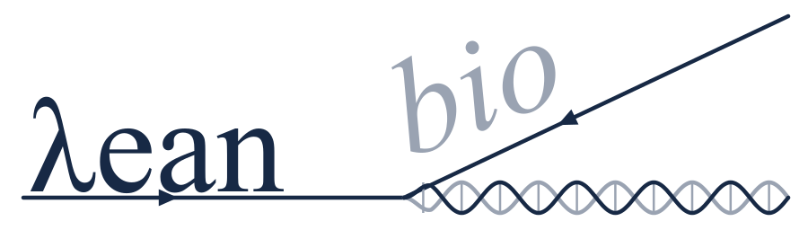

<div align="center">

</div>

<div align="center">

## Candidate laws of biology, machine-checked in Lean 4

[](https://delphibio.org/laws/)
[](https://delphibio.org)
[](CONTRIBUTING.md)
[](LICENSE)

[](https://github.com/leanprover/lean4/releases/tag/v4.35.0)
[](lean/registry/lawsets/current.json)
[](https://github.com/fractastical/leanbio/actions/workflows/build.yml)
[](https://gitpod.io/#https://github.com/fractastical/leanbio)
[](https://deepwiki.com/fractastical/leanbio)

</div>

<table>
<tr>
<td colspan="3" align="center">

<sub><b>UPSTREAM</b></sub> · [**Mathlib**](https://github.com/leanprover-community/mathlib4) ↑

</td>
</tr>
<tr>
<td colspan="3" align="center">

<sub><b>THIS REPOSITORY</b></sub>

</td>
</tr>
<tr>
<td width="33%" valign="top">

### [**Delphi**](lean/Delphi)

The Lean modules. Each file's header says which assumptions are inside the kernel and which are left outside; read it before citing a theorem.

</td>
<td width="33%" valign="top">

### [**Certificates**](lean/Delphi/Certificates)

Elimination certificates, theorems of the form `*_rules_out`: a design violates a law under stated parameters.

</td>
<td width="33%" valign="top">

### [**Registry**](lean/registry)

One file per law, pinned to a module path and a statement hash. Laws move `proposed → candidate → accepted → contested → retired`, and are retired, never removed.

</td>
</tr>
<tr>
<td colspan="3" align="center">

<sub><b>ADJACENT</b></sub> · [**Physlib**](https://github.com/leanprover-community/physlib) · [**Delphi**](https://github.com/fractastical/delphi) →

</td>
</tr>
</table>

A proof here shows that a statement follows from a named model; whether organisms satisfy the model is an empirical question, answered elsewhere by data tests. LeanBio follows [Physlib](https://github.com/leanprover-community/physlib)'s conventions and shares its toolchain and Mathlib pin (`v4.35.0`), so a result can move between the two without a port. The laws, joined to the claims, data tests and images, are at [delphibio.org/laws](https://delphibio.org/laws/).

## What is in it

| path | what |
|---|---|
| `lean/Delphi/` | the Lean modules. Each file's header says which assumptions are inside the kernel and which are left outside; read it before citing a theorem |
| `lean/Delphi/Certificates/` | elimination certificates: theorems of the form `*_rules_out` that show a design violates a law under stated parameters |
| `lean/registry/` | the law registry: one JSON file per law, pinned to a module path and a statement hash, with a lifecycle (`proposed → candidate → accepted → contested → retired`) and versioned law sets. Nothing is ever deleted; laws are retired, never removed. See [lean/registry/README.md](lean/registry/README.md) |
| `lean/laws.json`, `lean/constraints.json`, `lean/empirical.json` | the pre-registry law list, the engineering constraints each law backs, and the empirical observations the registry was bootstrapped from |
| `lean/morphology-grounding.json` | the anatomy terms (Uberon) the theorems are grounded on |

Every theorem compiles with no `sorry` and only Lean's standard axioms (`propext`, `Classical.choice`,
`Quot.sound`); `lean/Delphi/Audit.lean` prints the axioms of every headline theorem.

## Build

```sh
curl https://raw.githubusercontent.com/leanprover/elan/master/elan-init.sh -sSf | sh -s -- -y --default-toolchain none
lake exe cache get     # Mathlib's prebuilt cache, several GB
lake build
lake env lean lean/Delphi/Audit.lean
node lean/registry/test.mjs   # registry: schema, content hashes, statement pins
```

## Adding a law

Write the theorem in a Lean file with the header shown in [CONTRIBUTING.md](CONTRIBUTING.md), give its
hypotheses names, provide a non-vacuity witness, then:

```sh
node lean/registry/propose.mjs path/to/law.lean --meta meta.json --write
```

The script compiles the file, checks axioms, computes the content hash and writes the law as
`proposed`. Promotion to `accepted` is a human edit to the law file, recorded with a role, never a
personal identifier. `node lean/registry/release.mjs <semver> "<note>"` cuts a new law set.

## Status

Law set 1.6.0: 64 laws (36 accepted, 16 candidate, 7 proposed, 3 contested, 2 retired) across
scaling, flight, physiology, population genetics, cell geometry, crystallography and pattern formation.
The current list, with the claims, data tests and images each law is joined to, is at
[delphibio.org/laws](https://delphibio.org/laws/).

Not yet moved here: the Lean projects attached to individual source works in the Delphi repo
(`ThompsonLaws`, `DarwinLaws`, `WolframLaws`, the hygromorph mechanics) and the `Patterns`
generators. Five of the laws are physics (Boyle, Fick, Bragg, the crystallographic restriction,
Plateau's rules). Checked against Physlib `31a3730` on 10 November 2026: Physlib has none of them,
so LeanBio still states them. Boyle is the nearest miss. Physlib proves `P V = n R T` and notes that
Boyle follows, without proving it, while LeanBio takes `P V` constant as a hypothesis of the
swim-bladder theorem rather than proving it. The search and the per-law result are in
[docs/physlib-overlap.md](docs/physlib-overlap.md). When Physlib ships one of the five, LeanBio
should depend on it instead of restating it.

## License

Apache 2.0, as Mathlib and Physlib. See [LICENSE](LICENSE). Contributions, including AI-assisted
ones, follow [AI-POLICY.md](AI-POLICY.md).
